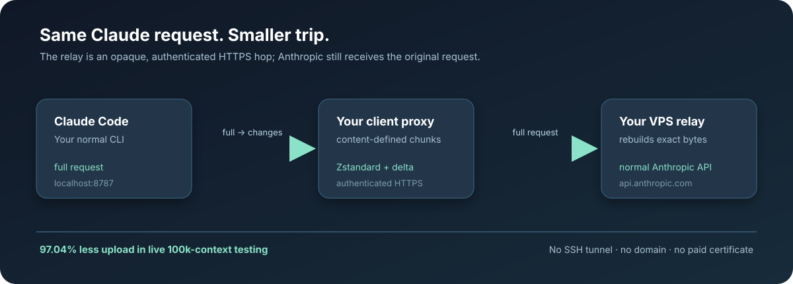
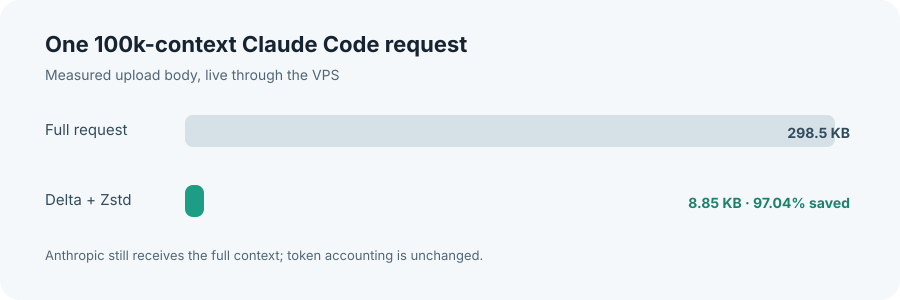

# Claude TX Saver

The relay is implemented in Rust for a small, self-contained deployment binary.
The wire protocol remains version 3, so existing clients can be upgraded without
changing credentials or the Claude Code integration.

<p align="center"><strong>Stop uploading the same Claude Code context on every turn.</strong></p>
<p align="center"><a href="https://github.com/mohsenyz/claude-tx-saver/actions/workflows/test.yml"></a> <a href="https://github.com/mohsenyz/claude-tx-saver/releases"></a> <a href="LICENSE"></a></p>

Claude Code resends its growing conversation. On a slow or metered connection,
that means paying to upload the same context again and again. Claude TX Saver
sends changed chunks over an encrypted link to a VPS, rebuilds the exact request,
and lets Claude continue as normal.

<p align="center"></p>

## Quick start

### Install a prebuilt release

Release artifacts are published for Linux x86_64 and macOS Apple Silicon. The
`claude-tx-saver` binary provides both `server` and `client` modes; the shell
installers below configure TLS, credentials, and Claude Code settings around it.

**1. On your Linux VPS, as root:**

```sh
curl -fsSLO https://github.com/mohsenyz/claude-tx-saver/releases/latest/download/server.sh
bash server.sh
```

The server detects its public IPv4, creates a self-signed certificate, and prints
the next command. No domain, certificate purchase, or TLS setup is needed.

**2. On your Mac or Linux machine:**

```sh
curl -fsSLO https://github.com/mohsenyz/claude-tx-saver/releases/latest/download/client.sh
bash client.sh YOUR_VPS_IP
claude
```

The client uses SSH once to copy the private relay credentials. Normal traffic
then uses authenticated HTTPS; there is no SSH tunnel. Restart any Claude Code
session that was already open.

For a source build, install Rust stable (1.90 or newer) and run `cargo build --release`.
The resulting `target/release/claude-tx-saver` accepts the same `client` and
`server` arguments documented by `--help`.

### Docker

Use the same two commands with `--docker`:

```sh
bash server.sh --docker
bash client.sh --docker YOUR_VPS_IP
```

Docker mode needs a running Docker daemon. The client is published only on
`127.0.0.1:8787`; the server publishes HTTPS on port `8443`. Allow TCP 8443 in
your VPS/cloud firewall.

## What changes on the wire?

```text
first turn:  [full context] ── compressed chunks ──▶ VPS cache
next turn:   [same context + “fix it”] ── changed chunks ──▶ VPS rebuilds full request
                                                              └─▶ Anthropic
```

Anthropic receives the original request. The proxy does not understand or rewrite
models, tools, thinking blocks, authentication formats, headers, or SSE events.

## Measured result

Real Claude Code calls with **100,126 context tokens**:

<p align="center"></p>

| Scenario | Full upload | Delta + Zstd | Reduction |
|---|---:|---:|---:|
| Live Claude Code | 298.5 KB | 8.85 KB | **97.04%** |
| Identical context | 291 KB | 1.19 KB | **99.59%** |
| Small appended turn | 295 KB | 7.14 KB | **97.58%** |

Delta saves the bandwidth. Compression alone was faster on the tested link
(211 ms versus 231 ms for an identical request), because scanning the context costs
about 48 ms. Live first-token timing showed no reliable speedup. Input tokens and
Anthropic billing do not change.

[Full report](benchmarks/results/REPORT.md) · [Methodology and reproduction](benchmarks/README.md)

The benchmark harness is intentionally retained so Rust releases can be compared
with the protocol baseline. Run `python3 benchmarks/run.py --help` for the
available local and live scenarios.

## Updates and removal

Both scripts remember the server address, credentials, install mode, and Claude
settings. Update the server first, then the client:

```sh
claude-tx-server --update
~/.local/bin/claude-tx-client --update
```

Remove the local service and restore the previous Claude URL:

```sh
bash client.sh --uninstall
```

Stop the server with `systemctl disable --now claude-proxy` or
`docker rm -f claude-tx-saver-server`.

## Trust boundary

Your VPS can read the full context and Anthropic authentication headers. Use a
server you trust. Credentials live outside this checkout in
`~/.config/claude-proxy/` and `/etc/claude-proxy/`. Requests are buffered; responses
stream. HTTP and SSE are supported. WebSockets, trailers, and streaming request
uploads are outside scope. See [SECURITY.md](SECURITY.md).

[Contributing](CONTRIBUTING.md) · [MIT license](LICENSE)

Independent project; not affiliated with Anthropic.
